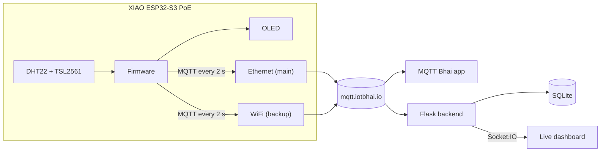

<div align="center">

# I Killed the WiFi and My Sensor Didn't Care

### A WiFi + Ethernet failover IoT node on the Seeed Studio XIAO ESP32-S3 PoE

*Ethernet is the main link, WiFi is the backup. Pull the cable or kill the WiFi:
the node keeps publishing to MQTT, and a live dashboard proves it.*


**[Video](#video)** · **[Pin map](#pin-map)** · **[Quick start](#quick-start)** · **[Dashboard](#2-run-the-dashboard)** · **[Demo](#the-demo)** · **[Troubleshooting](#troubleshooting)**

</div>

---

## What it does

WiFi-only IoT devices drop off silently: a crowded 2.4 GHz band, a metal cabinet,
a motor starting up, and the data just stops. This node never goes dark.

- **Two links, one connection.** The W5500 Ethernet chip and WiFi share the same
  network stack, so one MQTT connection rides whichever link is alive.
- **Ethernet first.** Plug the cable in and the node moves to it, even if WiFi is
  fine. Pull it and it fails over to WiFi in about 2–4 seconds.
- **Losing the backup costs nothing.** Kill the WiFi while on Ethernet and the
  MQTT connection isn't even touched.
- **Real sensors.** DHT22 temperature and humidity, and TSL2561 light, published
  every 2 seconds.
- **On-board OLED** shows the active link, the sensor values, WiFi signal and IP.
- **Live web dashboard** (Flask + Socket.IO + SQLite) with a link timeline,
  per-sensor charts, a failover log and node info. No page refresh needed.
- **Power over Ethernet.** One cable powers the board and carries the data.

## Video

> **Part 2, this project:** `[add YouTube link]`
>
> **Part 1, getting started with Ethernet, PoE and MQTT:** `[add YouTube link]` ·
> code: [xiao-esp32-s3-ethernet-speedtest-mqtt](https://github.com/ittipu/xiao-esp32-s3-ethernet-speedtest-mqtt)

## How it works



When a link goes up or down, the firmware:

1. picks the active link: Ethernet if the cable is in, otherwise WiFi;
2. makes that interface the network's **default route**, so traffic and the
   reported `link` always match;
3. **only if the active link changed**, closes the old MQTT socket and reconnects
   over the new one, using a cached broker IP so it never waits on DNS from a
   dead network.

The publish counter only counts messages that really went out, so it never skips a number.

## Hardware

| Part | Notes |
|---|---|
| **Seeed Studio XIAO ESP32-S3 PoE** | XIAO ESP32-S3 Plus + W5500 Ethernet + PoE (IEEE 802.3af) on one board |
| **DHT22** | Temperature and humidity |
| **TSL2561** | Light sensor (lux), I²C |
| **1.3" OLED, 128×64, I²C** | Optional. SH1106 controller (0.96" SSD1306 also supported) |
| **PoE switch or injector** | IEEE 802.3af, plus a Cat5e/Cat6 cable |
| Jumper wires, breadboard | |

**Get the hardware from Seeed Studio:**

- XIAO ESP32-S3 PoE: `[add Seeed link]`
- [XIAO W5500 Ethernet Adapter](https://www.seeedstudio.com/XIAO-W5500-Ethernet-Adapter-p-6472.html?sensecap_affiliate=itSHeV7&referring_service=link)

> These are affiliate links. They cost you nothing extra and support the IoT Bhai channel.

## Pin map

| XIAO pin | GPIO | Used for | Connect to |
|---|---|---|---|
| **D0** | GPIO1 | DHT22 data | DHT22 **DATA** |
| D1 | GPIO2 | W5500 CS | *on-board, don't use* |
| D2 | GPIO3 | free | — |
| D3 | GPIO4 | free | — |
| **D4** | GPIO5 | I²C SDA | TSL2561 **SDA**, OLED **SDA** |
| **D5** | GPIO6 | I²C SCL | TSL2561 **SCL**, OLED **SCL** |
| D6 | GPIO43 | UART TX | free |
| D7 | GPIO44 | UART RX | free |
| D8 | GPIO7 | W5500 SCK | *on-board, don't use* |
| D9 | GPIO8 | W5500 MISO | *on-board, don't use* |
| D10 | GPIO9 | W5500 MOSI | *on-board, don't use* |
| **3V3** | — | power | DHT22 VCC, TSL2561 VIN, OLED VCC |
| **GND** | — | ground | all GND pins |

```
                 XIAO ESP32-S3 PoE
              ┌─────────────────────┐
  DHT22 DATA ─┤ D0               5V ├─
   (on-board) ┤ D1 W5500 CS     GND ├─── GND  (DHT22, TSL2561, OLED)
              ┤ D2              3V3 ├─── 3V3  (DHT22, TSL2561, OLED)
              ┤ D3        D10 MOSI  ├ (on-board W5500)
    SDA bus  ─┤ D4 SDA     D9 MISO  ├ (on-board W5500)
    SCL bus  ─┤ D5 SCL     D8 SCK   ├ (on-board W5500)
              ┤ D6 TX      D7 RX    ├
              └──────────┬──────────┘
                     RJ45 / PoE  ── one cable: power + Ethernet
```

### Wiring each part

| DHT22 | XIAO | | TSL2561 | XIAO | | OLED | XIAO |
|---|---|---|---|---|---|---|---|
| VCC | 3V3 | | VIN | 3V3 | | VCC | 3V3 |
| DATA | **D0** | | GND | GND | | GND | GND |
| GND | GND | | SDA | **D4** | | SDA | **D4** |
| | | | SCL | **D5** | | SCL | **D5** |

- A bare 4-pin DHT22 needs a **10 kΩ pull-up from DATA to 3V3**. 3-pin modules already have one.
- TSL2561: leave **ADDR** and **INT** unconnected (I²C address 0x39). The OLED is 0x3C, so both share the bus.
- Power every sensor from **3V3**, never 5V: the XIAO's pins are 3.3 V only.
- D1, D8, D9 and D10 are wired to the W5500 on the board. Don't connect anything to them.

More detail: [WIRING.md](WIRING.md).

## Quick start

### 1. Flash the firmware

**Arduino IDE setup**

| Setting | Value |
|---|---|
| Board package | **esp32 by Espressif**, version **3.1.0 or newer** |
| Board | **XIAO_ESP32S3** (defines the `D0`–`D10` pin names) |
| Libraries (Library Manager) | **PubSubClient**, **DHT sensor library**, **Adafruit Unified Sensor**, **Adafruit TSL2561**, **U8g2** (for the OLED) |
| Ethernet | The built-in `ETH.h`. Do **not** install the Arduino `Ethernet` library. |

**Steps**

1. Open [`xiao_s3_wifi_eth_failover/xiao_s3_wifi_eth_failover.ino`](xiao_s3_wifi_eth_failover/xiao_s3_wifi_eth_failover.ino).
2. Copy `secrets.example.h` to **`secrets.h`** in the same folder and fill in your WiFi name and password.
   `secrets.h` is git-ignored, so your password never lands on GitHub.
3. Check the settings at the top of the sketch (table below).
4. Select the board and port, then **Upload**.
5. Open the Serial Monitor at **115200 baud**.

**Settings in the sketch**

| Setting | Default | What it does |
|---|---|---|
| `PREFER_ETHERNET` | `1` | `1` = Ethernet main, WiFi backup. `0` = WiFi main. |
| `USE_OLED` | `1` | Set `0` if no OLED is connected. |
| `OLED_SH1106` | `1` | `1` for 1.3" SH1106 OLEDs, `0` for 0.96" SSD1306. |
| `MQTT_HOST` / `MQTT_PORT` | `mqtt.iotbhai.io` / `1883` | Your MQTT broker. |
| `MQTT_TOPIC` | `iotbhai/node` | Where readings are published. |
| `PUBLISH_INTERVAL_MS` | `2000` | Publish rate. The DHT22 can't be read faster than every 2 s. |
| `WIFI_BEACON_TIMEOUT_S` | `3` | How fast a dead WiFi is noticed (ESP-IDF default is 6). |

**Serial Monitor output (example)**

```text
=== IoT Bhai - WiFi/Ethernet Failover Node ===
[tsl2561] found
waiting for a link...
[wifi] IP: 192.168.0.84
online via WiFi
[net] link change none -> WiFi (wifi=1 eth=0)
[dns] mqtt.iotbhai.io -> x.x.x.x
[mqtt] connect over WiFi : OK (140 ms)
[mqtt] {"link":"WiFi","temp":32.1,"hum":63.0,"lux":111.0,"count":1,...}
[eth] cable connected
[eth] IP: 192.168.0.58
[net] link change WiFi -> ETH (wifi=1 eth=1)
[mqtt] connect over ETH : OK (95 ms)
```

### 2. Run the dashboard

You need **Python 3.10+**.

```bash
cd dashboard
python -m venv venv
```

```bash
venv\Scripts\activate
```

On macOS/Linux, activate with `source venv/bin/activate` instead.

```bash
pip install -r requirements.txt
```

```bash
python app.py
```

Open **http://localhost:5000**. The backend subscribes to the broker, stores every
reading in SQLite and pushes updates to the browser live.

**No hardware yet?** Run the simulator in a second terminal. It plays the whole
demo story with fake data, and refuses to run while a real node is publishing on
the same topic.

```bash
python simulate.py
```

All dashboard settings, its features and the full payload reference are in
[dashboard/README.md](dashboard/README.md).

### 3. Watch it on your phone (optional)

Open the **MQTT Bhai** app, connect to `mqtt.iotbhai.io`, and subscribe to `iotbhai/node`.

## The demo

| Step | Do this | You'll see |
|---|---|---|
| 1 | Boot with the Ethernet cable **unplugged** | Node runs on **WiFi** (backup) |
| 2 | Plug the cable in | Moves to **Ethernet** (main) within ~2 s |
| 3 | **Kill the WiFi** | Nothing happens. Still on Ethernet, no gap, counter climbing. |
| 4 | Bring WiFi back, then **pull the cable** | **Failover** to WiFi. The counter keeps going. |
| 5 | Plug the cable back | Returns to Ethernet |

On the dashboard, the link track goes blue (WiFi) and aqua (Ethernet), and the
sensor lines run straight through every switch. A red striped band would mean
data actually stopped.

## MQTT

| Topic | Direction | Payload |
|---|---|---|
| `iotbhai/node` | node → broker | Readings every 2 s (below) |

```json
{"link":"ETH","temp":27.4,"hum":61.2,"lux":312.0,"count":123,"wifi":1,"eth":1,
 "rssi":-58,"up":7980,"ip":"192.168.0.58","fw":"1.3.1","pref":"ETH"}
```

| Field | Meaning |
|---|---|
| `link` | Active link: `ETH` or `WiFi` |
| `temp`, `hum` | DHT22 temperature (°C) and humidity (%) |
| `lux` | TSL2561 light level |
| `count` | Messages published since boot |
| `wifi`, `eth` | Whether each link is up (1/0) |
| `rssi` | WiFi signal in dBm, `null` while WiFi is down |
| `up` | Uptime in seconds |
| `ip` | IP of the active link |
| `fw` | Firmware version |
| `pref` | The main link (`ETH` or `WiFi`) |

A sensor that fails to read is sent as `null`, never as a made-up number.

## OLED screen

```
IoT Bhai                    #123     title + messages sent
──────────────────────────────────
█████████    Ethernet    █████████     active link (redraws instantly on a switch)
32.1°C          63%         312lx    temperature | humidity | light
-56 dBm              192.168.0.58    WiFi signal | IP of the active link
```

## Troubleshooting

| Problem | Fix |
|---|---|
| `D0`, `D1`… "not declared" | Select the board **XIAO_ESP32S3**, not "ESP32S3 Dev Module". |
| `secrets.h: No such file` | Copy `secrets.example.h` to `secrets.h` and fill in your WiFi. |
| `ETH.begin` or `Network.setDefaultInterface` doesn't compile | Update the esp32 board package to **3.1.0 or newer**. |
| OLED: left edge cut off, line down the right side | Wrong controller: flip `OLED_SH1106` (1 ↔ 0). |
| `[tsl2561] NOT found` | Check SDA → D4, SCL → D5, 3V3 and GND. |
| Temperature/humidity show `--` | Check DHT22 DATA → D0 and the 10 kΩ pull-up on a bare sensor. |
| Stays on WiFi with the cable in | Check the PoE switch/router link LEDs and that DHCP gives the board an IP (`[eth] IP:` in Serial). |
| Dashboard shows constant link flips | Two publishers on one topic: stop `simulate.py` (or the second board). |
| Dashboard can't reach the broker | Check `MQTT_HOST`/`MQTT_PORT` and that port 1883 isn't blocked on your network. |

## Project layout

```text
.
├── README.md
├── WIRING.md                       # pin map + wiring detail
├── LICENSE
├── xiao_s3_wifi_eth_failover/
│   ├── xiao_s3_wifi_eth_failover.ino   # firmware
│   └── secrets.example.h               # copy to secrets.h (git-ignored)
└── dashboard/
    ├── app.py                      # Flask + Socket.IO + MQTT bridge
    ├── db.py                       # SQLite storage
    ├── simulate.py                 # fake node for testing
    ├── requirements.txt
    ├── README.md                   # dashboard details
    ├── templates/index.html
    └── static/                     # style.css, dashboard.js
```

## About

Made by **IoT Bhai** in collaboration with **Seeed Studio**.

`esp32 ethernet` · `w5500` · `power over ethernet` · `PoE` · `wifi failover` · `MQTT` · `XIAO ESP32-S3`

## License

Released under the [MIT License](LICENSE).
