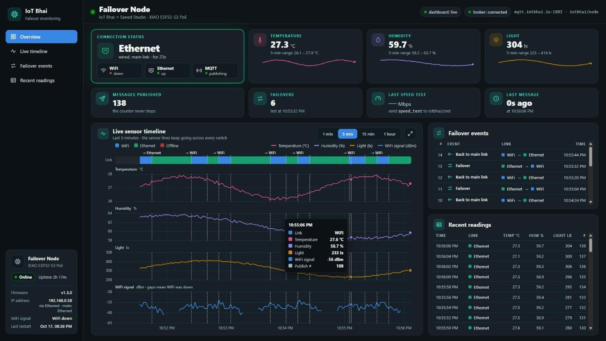

# Failover Dashboard



Live web dashboard for the WiFi → Ethernet failover node. It shows the **active
link**, live **temperature, humidity and light** (DHT22 + TSL2561), **WiFi signal
strength**, the **publish counter**, node info (**uptime, firmware, IP, last
restart**), a **live timeline** of the link and every sensor, and a **failover
event log**, all updating in real time with no page refresh.

```
ESP32 ──MQTT(1883)──► mqtt.iotbhai.io ──► Flask (paho-mqtt) ──► SQLite
                                              │
                                     Flask-SocketIO ──WebSocket──► Browser
```

The browser never talks to MQTT directly. The Flask backend subscribes to the
broker, stores every reading and link switch in SQLite, and pushes updates to the
page over Socket.IO.

## Run it

```bash
cd dashboard
python -m venv venv
venv\Scripts\activate        # Windows  (macOS/Linux: source venv/bin/activate)
pip install -r requirements.txt
python app.py
```

Open **http://localhost:5000**.

### No hardware yet? Use the simulator

`simulate.py` publishes the same payload as the real node (Ethernet as the main
link) and plays the demo story: WiFi only → cable plugged in (moves to Ethernet)
→ WiFi killed (no change) → WiFi back → cable pulled (failover to WiFi) → cable
back.

```bash
python simulate.py           # one cycle, about 80 s
python simulate.py --loop    # repeat until Ctrl+C
```

It refuses to run while a real node is publishing on the same topic, because two
publishers look like constant link flips. `--force` overrides that.

## What the dashboard shows

| Area | What it means |
|---|---|
| **Sidebar** | Jump links to each section, plus the **node card**: online/offline, uptime, firmware version, IP (and which link it's on), WiFi signal, last restart. |
| **Connection status** | WiFi (blue) / Ethernet (aqua) / Offline (red). Offline means nothing arrived for 6 s. The WiFi, Ethernet and MQTT chips show each one's state. |
| **Sensor tiles** | Latest temperature, humidity and light, with the 5-minute range and a sparkline. |
| **KPI tiles** | Messages published, failovers (and when the last one happened), the last speed test, and time since the last message. |
| **Live timeline** | The link track plus temperature, humidity, light and WiFi-signal charts, all on one time axis. Pick **1 min / 5 min / 15 min / 1 hour**; the ⤢ button makes it full screen for filming. Dashed lines mark every switch; hover to read every value at that moment. |
| **Failover events** | Every switch, stored in SQLite: *Failover* (away from the main link, counted), *Back to main link* (not counted), *Online*, and *Node restarted* (detected when uptime goes backwards). The main link comes from the node's `pref` field. |
| **Recent readings** | The latest readings as a table (Show more for 30). |

## MQTT payload

Topic `iotbhai/node`, one message every 2 s:

```json
{"link":"ETH","temp":27.4,"hum":61.2,"lux":312.0,"count":123,"wifi":1,"eth":1,
 "rssi":-58,"up":7980,"ip":"192.168.0.58","fw":"1.3.0","pref":"ETH"}
```

| Field | Meaning |
|---|---|
| `link` | Active interface: `WiFi` or `ETH` |
| `temp`, `hum` | DHT22 temperature (°C) and humidity (%) |
| `lux` | TSL2561 light level |
| `count` | Messages published since boot |
| `wifi`, `eth` | Whether each interface is up (1/0) |
| `rssi` | WiFi signal in dBm, `null` while WiFi is down |
| `up` | Uptime in seconds |
| `ip` | IP address of the active link |
| `fw` | Firmware version |
| `pref` | The node's main link (`ETH` or `WiFi`); older firmware without it counts as `WiFi` |

A sensor that fails to read sends `null`, and the dashboard shows a gap instead
of a fake value.

## Configuration

All optional; the defaults match this project.

| Variable | Default | Meaning |
|---|---|---|
| `MQTT_HOST` | `mqtt.iotbhai.io` | Broker host |
| `MQTT_PORT` | `1883` | Broker port (plain MQTT) |
| `MQTT_USER` / `MQTT_PASS` | empty | Broker credentials, if any |
| `TOPIC_NODE` | `iotbhai/node` | Sensor data topic |
| `TOPIC_SPEED` | `iotbhai/speed` | Speed-test result topic |
| `HTTP_PORT` | `5000` | Port the dashboard is served on |
| `DB_PATH` | `dashboard/dashboard.db` | SQLite file |

## Before filming

- **Start clean:** stop the server, delete `dashboard.db`, and start it again, so
  the failover count and the event log begin at zero.
- Record the browser at **1920×1080** (press F11 for a full-screen browser).
  On screens at least **1501 px wide and 820 px tall** the dashboard **fits the
  window with no scrolling**: the timeline stretches to fill the height, and the
  events and readings tables sit beside it and scroll inside their own boxes.
  Smaller screens (laptops, phones) fall back to a normal scrolling page.
- Click ⤢ on the timeline for a full-screen view of just the charts during the switch.

## Files

```
dashboard/
├── app.py                 # Flask + Socket.IO + MQTT bridge
├── db.py                  # SQLite storage (readings, events, speed tests)
├── simulate.py            # fake node for testing without hardware
├── requirements.txt
├── dashboard.db           # created on first run (git-ignored)
├── templates/index.html
└── static/
    ├── style.css
    └── dashboard.js
```

## Notes

- **It needs a running server** (Flask), so it can't be hosted on GitHub Pages.
  Run it on your laptop during filming, or on any small server.
- The database is created automatically and upgrades itself from older versions.
- The dashboard reconnects on its own if the backend or the broker drops.
- The colours were checked for colour-blind safety and contrast; "Offline" also
  uses a stripe pattern and a text label, so it never relies on colour alone.
